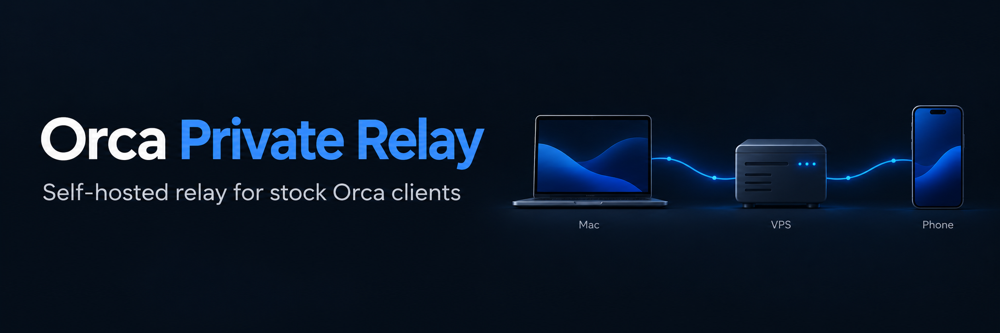

# Orca Private Relay

Личный Relay на Rust для **готовых клиентов Orca**. Mac и телефон подключаются к
вашему VPS, а проекты и агенты продолжают работать на Mac.

**Без форка Orca, пересборки клиентов, VPN и отдельного коннектора на Mac.**

```text
Orca на Mac ── исходящий WSS ──► ваш VPS ◄── исходящий WSS ── Orca на телефоне
```

Проверено со штатной **Orca 1.4.245 на macOS** и Orca на **OPPO / Android**.
Владелец подтвердил доступ к Mac и сессиям через мобильный интернет с выключенным Wi‑Fi.
Это независимый проект, не официальный сервер Orca.

## Что внутри

| На VPS | На Mac | На телефоне |
| --- | --- | --- |
| Один Rust-бинарник и systemd | Существующая Orca | Существующая Orca Mobile |
| Caddy для HTTPS / WSS | Настройки адресов при запуске | Обычное сопряжение по QR |
| SQLite для сеансов и ключей устройств | Без фонового коннектора | Без VPN для этого соединения |

Сервис передаёт **зашифрованные кадры Orca**, сохраняя её сквозное шифрование между
телефоном и Mac. На VPS нет ключей расшифровки этой сессии. Код, переписки и вывод
терминала в базу и логи не записываются. Сервер видит метаданные соединений и объём трафика.

Работают вход через PKCE, проверка владения ключом Mac, приглашения, повторные
подключения телефона, смена ключей и отзыв устройств. Очереди ограничены; медленный
получатель создаёт обратное давление, вместо бесконечного накопления данных.

На первом VPS с 1 vCPU и 2 ГБ RAM процесс занимал около **7 МБ RSS** при небольшой
нагрузке. Это измерение одного стенда, а не оценка предельной производительности.

## Установка на свой VPS

### Короткий путь

Сервер настраивается **один раз**. Подключение второго Mac не требует доступа
к VPS, SSH-ключа, SSH-пароля или повторного запуска установщика.

```bash
git clone https://github.com/AndreyZlobin/orca-private-relay.git && cd orca-private-relay
./relay install --host root@203.0.113.10 --ask-pass
```

Установка автоматически создаст приватный файл `.private/connection.json`
с адресом и ключом владельца. Для ранее установленного Relay создайте его на
том компьютере, с которого выполнялась установка: `./relay export`.

Передайте этот файл на свой второй Mac. В скачанном репозитории выполните:

```bash
./relay connect --profile ~/Downloads/connection.json
```

Команда проверит сертификат, доступность Relay и ключ, применит настройки Mac,
перезапустит Orca и положит ключ входа в буфер обмена. Ошибка HTTPS или неверный
ключ останавливают процесс до изменения настроек Mac.

**Оставшиеся действия в штатной Orca:** открыть «Orca Mobile → Orca Relay →
Войти для Relay», вставить ключ через Cmd+V и отсканировать телефоном QR.
Скрипт не утверждает, что вход или сопряжение выполнены автоматически. В Orca
1.4.245 для этих действий нет команд в доступной CLI-схеме.

Файл подключения содержит ключ владельца: передавайте его только между своими
устройствами. Он сохраняется с правами `0600` внутри игнорируемой `.private`.
Идентификатор, ключи и история самой Orca с другого компьютера не копируются.

```bash
./relay doctor       # HTTPS и настройки Mac, без SSH и изменений
./relay disconnect   # восстановить предыдущие настройки запуска
```

Если файла нет, `./relay connect --origin https://relay.example.com` запросит
ключ владельца один раз в терминале. `--no-restart` позволяет отложить перезапуск.
Полную проверку доступа с телефона по мобильной сети выполняет владелец.

### Подробности установки

Нужен обычный **Linux x86‑64 VPS с SSH-доступом по ключу или паролю**: root либо пользователь
с `sudo -n`. Проверенный сервер — Ubuntu 24.04; установщик также допускает Ubuntu
22.04/26.04 и Debian 12/13. Для сборки из исходников рекомендуется 2 ГБ RAM.
**Docker, Caddy, Python 3, curl и сетевые зависимости устанавливаются автоматически.**

Сначала скачайте репозиторий на свой компьютер:

На компьютере, с которого запускается установка, нужны Python 3 и SSH. Rust и
Docker локально не требуются: сборка выполняется на VPS.

```bash
git clone https://github.com/AndreyZlobin/orca-private-relay.git
cd orca-private-relay
python3 scripts/deploy.py --host root@203.0.113.10
```

Замените пример IP на адрес VPS. На сервере ничего готовить вручную не требуется:
установщик проверит ОС, установит недостающее ПО, соберёт бинарник, создаст ключи,
пользователя и автозапуск, настроит HTTPS и правила TCP 80/443. В конце он проверит
публичный HTTPS. Локальная копия ключа владельца сохранится в `.private/owner.key`;
серверный оригинал остаётся в закрытом файле окружения на VPS.

Свой домен необязателен. По публичному IPv4 будет автоматически получен адрес вида
`https://orca-relay.203-0-113-10.sslip.io`, а Caddy выпустит и будет обновлять сертификат.
sslip.io предоставляет DNS, трафик сессии через него не проходит. Для постоянного
адреса можно указать свой домен, заранее направленный на VPS.

Параметры сохраняются в `.private/deploy.json`. Можно также создать его заранее:

```json
{
  "ssh_host": "root@203.0.113.10"
}
```

Необязательные поля: `origin` для собственного HTTPS-домена без завершающего `/`,
`ssh_port`, `ssh_key` (путь к SSH-ключу) и `public_ipv4` (если `ssh_host` — SSH alias).

```bash
python3 scripts/deploy.py
# Посмотреть план, ничего не устанавливая:
python3 scripts/deploy.py --plan
# Посмотреть состояние уже установленного сервера:
python3 scripts/deploy.py --status
```

Если на этом компьютере нет SSH-ключа, используйте `--ask-pass`:

```bash
python3 scripts/deploy.py --host deploy@203.0.113.10 --ask-pass --plan
python3 scripts/deploy.py --host deploy@203.0.113.10 --ask-pass
```

OpenSSH один раз запросит пароль пользователя VPS в терминале. Скрипт использует
одно соединение для всех шагов и закрывает его при завершении. Пароль не
записывается в конфигурацию или временный файл и не передаётся аргументом команды.
При `--ask-pass` поле `ssh_key` игнорируется. Сервер должен уже разрешать вход по
паролю выбранному пользователю; установщик сам не включает парольный вход и не
открывает root. Пользователю `deploy` по-прежнему нужен `sudo -n`.

Сборка проходит **на VPS**, только когда изменились исходники, в одноразовом
официальном Rust-контейнере с ограничением CPU и памяти. Контейнер удаляется после
сборки; Relay работает нативным бинарником. При необходимости принудительной сборки
используйте `--rebuild`. Node.js и Python не нужны для работы самого Relay.

Установщик создаёт отдельного системного пользователя, приватную базу и секреты,
настраивает systemd и HTTPS. Предыдущие изменяемые файлы сохраняются для отката;
при ошибке применения восстанавливаются предыдущие файлы и работавший сервис.
При повторном запуске существующие секреты и записи устройств сохраняются.
Если бинарник, настройки и systemd unit не изменились, Relay не перезапускается.

Существующие Docker и Caddy переиспользуются. Установщик не меняет конфигурацию
Docker, не перезапускает работающий Docker и не очищает чужие firewall-цепочки.
Для HTTP/HTTPS добавляется только своя цепочка `ORCA-RELAY-IN`, без изменений SSH.
Если 80/443 заняты другим веб-сервером либо существующий container runtime пришлось бы
заменить, установка остановится с объяснением вместо удаления работающего ПО.
Внешний firewall в панели провайдера должен разрешать TCP 80/443: без API-доступа
к провайдеру изменить его с самого VPS невозможно.

Проверены установка зависимостей в чистом контейнере Ubuntu 24.04, применение на
работающем VPS и повторный запуск без перезапуска Relay, Caddy и Docker. Полный
первый запуск на отдельной пустой виртуальной машине пока не проверялся.

## Подключение готовой Orca

На Mac из этого репозитория выполните:

```bash
python3 scripts/configure-mac.py
# Либо без конфигурационного файла:
python3 scripts/configure-mac.py --origin https://relay.example.com
```

Скрипт задаёт штатные параметры `ORCA_RELAY_URL`, `ORCA_CLOUD_API_URL`,
`ORCA_CLOUD_AUTH_URL` и `ORCA_PUSH_GATEWAY_URL`. Файлы и подпись Orca не меняются.
Настройки macOS при входе в систему повторяются через небольшой LaunchAgent plist:
он задаёт переменные и сразу завершается, отдельный фоновый сервис не работает.
Исходные параметры сохраняются локально для отката.

1. Полностью закройте и заново откройте Orca.
2. Откройте **Orca Mobile → Orca Relay → Войти для Relay**.
3. Проверьте, что страница входа открылась **на вашем домене**. Подпись кнопки Orca
   остаётся прежней, адрес сервера берётся из настроек.
4. Введите ключ владельца из `RELAY_OWNER_SECRET` в `/etc/orca-private-relay.env`
   на VPS. Это отдельный ключ вашего сервера; пароль аккаунта Orca здесь не нужен.
5. Отсканируйте свежий QR-код в существующем приложении Orca на телефоне.
6. Выключите Wi‑Fi на телефоне и проверьте доступ к сессиям через мобильную сеть.

Приглашение действует 10 минут. Старое сопряжение только по локальной сети может
потребовать повторного QR. **Mac должен быть включён и не спать.**

## Второй Mac с уже работающим Relay

Сервер повторно устанавливать не требуется. Основной путь — `./relay connect`
с файлом подключения из короткой инструкции выше. Ручной способ ниже оставлен
для совместимости с предыдущими инструкциями:

```bash
git clone https://github.com/AndreyZlobin/orca-private-relay.git
cd orca-private-relay
python3 scripts/configure-mac.py --origin https://relay.example.com
```

Замените `https://relay.example.com` адресом своего существующего Relay,
полностью перезапустите Orca, выполните вход с тем же ключом владельца и добавьте
на телефоне сопряжение по новому QR. SSH-доступ к VPS для этой настройки не нужен.
У каждого Mac должны оставаться собственные идентификатор и ключи Orca;
не копируйте профиль первого компьютера целиком.

## Обновление и обслуживание

```bash
git pull
python3 scripts/deploy.py
```

Обновление перезапускает Relay, только если изменились бинарник или его параметры;
повторное применение того же состояния сохраняет активные соединения.
Ключи телефона сохраняются в SQLite. Смена домена требует отдельной миграции —
установщик откажется незаметно менять адрес существующего сервера.

```bash
ssh deploy@203.0.113.10 'sudo systemctl status orca-private-relay'
ssh deploy@203.0.113.10 'sudo journalctl -u orca-private-relay -n 30 --no-pager'
curl --fail https://relay.example.com/healthz
```

| Путь | Назначение |
| --- | --- |
| `/usr/local/bin/orca-private-relay` | Нативный бинарник |
| `/etc/orca-private-relay.env` | Секреты сервера, доступ только root |
| `/var/lib/orca-private-relay/relay.sqlite` | Сеансы, хеши ключей устройств, квитанции установки |
| `/etc/caddy/conf.d/orca-private-relay.caddy` | HTTPS и WebSocket proxy |
| `/usr/local/lib/orca-private-relay/firewall.sh` | Идемпотентные правила TCP 80/443, также применяются при загрузке |
| `/opt/orca-private-relay/backups` | Предыдущие бинарники и Caddyfile |

Сам процесс слушает только `127.0.0.1:6770`, снаружи доступен через Caddy.
`/admin/status` требует ключ владельца в `Authorization: Bearer …` и возвращает
только счётчики хостов, устройств и соединений.

Для резервной копии сохраняйте SQLite и файл окружения вместе, в приватном месте.
Если VPS управляется декларативным инструментом, добавьте домен и порт 6770 в его
конфигурацию Caddy, чтобы следующий apply сохранил сайт Relay.

## Ограничения первой версии

- **Push-уведомления не реализованы.** Адрес push gateway направлен на свой VPS;
  этот сервер пока не заменяет доставку уведомлений Orca Cloud.
- Один владелец и один сервер. Нет организаций, биллинга, создания облачных профилей
  и миграций между регионами. Реализована необходимая часть протокола Orca.
- Перезапуск Relay не сохраняет текущие потоки данных: телефон переподключается.
- Совместимость проверена с 1.4.245; новые версии клиентов могут менять протокол.
- Изменения касаются маршрута Relay и его авторизации. Они не отключают сторонние
  API агентов, аналитику и проверку обновлений в исходных приложениях.

## Откат

```bash
python3 scripts/restore-mac.py
```

Перезапустите Orca и выберите локальную сеть. Скрипт восстановит предыдущие
параметры запуска и удалит только конфигурацию этой интеграции; профили Orca останутся.

Остановить сервер:

```bash
ssh deploy@203.0.113.10 'sudo systemctl disable --now orca-private-relay'
```

## Разработка

```bash
cargo test
cargo clippy --all-targets -- -D warnings
cargo fmt --check
python3 -m unittest discover -s tests -v
```

Интеграционный тест поднимает настоящий HTTP / WebSocket сервер и проверяет PKCE,
отказ при повторном использовании кода, доказательство владения ключом Mac,
приглашение, передачу бинарных кадров в обе стороны и повторное подключение телефона.
Отдельные проверки покрывают поддельные и отозванные токены, адрес перенаправления,
привязку криптографического доказательства и смену ключей устройств.

Протокол: [Orca v1.4.245](https://github.com/stablyai/orca/tree/v1.4.245).
Лицензия проекта — [MIT](LICENSE); уведомление об исходном протоколе —
[THIRD_PARTY_NOTICES.md](THIRD_PARTY_NOTICES.md).
